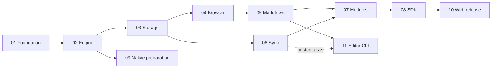

# edit.ac architecture and development roadmaps

This repository defines a Rust-first editor SDK for web, native iOS, Android, macOS, Windows and Linux, with a separate CLI/TUI client. It contains 37 roadmap files and 451 bounded parent tasks. These are development contracts, not claims of shipped capability; implementation status belongs in the runner’s separate progress and qualification evidence.

The user selected public repositories and Apache-2.0. [Decision 001](decisions/001-web-first.md) resolves scope, ownership, naming and release conflicts. [Decision003](decisions/003-extension-ecosystem.md) adds the requested extension, format, cloud and public-documentation delivery. The [original proposal](sources/initial-roadmap.md) is archived unchanged as reference material; current specs and task acceptance supersede it. [Decision 002](decisions/002-full-delivery.md) extends delivery beyond the initial browser release; the [requirement review](requirements.md) maps each requested capability to concrete tasks.

## Start here

Clone [core](https://github.com/edit-ac/core), this repository as `architecture`, optional [cli](https://github.com/edit-ac/cli), and [public docs](https://github.com/edit-ac/docs) into one parent directory. The parent itself is not a Git repository. Read the active task's named context rather than every document.

1. Check [setup evidence](evidence/setup.md), [dependency verification](evidence/dependencies.md) and the [full-delivery review](evidence/requirements-review.md).
2. Read [runner operation](operations/roadmap-runner.md), then the selected roadmap's entry gate.
3. Validate all sources with `npm ci --ignore-scripts` and `npm run check` in this repository. These commands do not execute workers or make inference calls.
4. Resume the designated runner using its recorded progress and immutable task source. Do not start a duplicate controller in an active checkout. Workers execute at most one parent per iteration; source checkboxes remain a template, not live progress.

## Milestones and task tracks

| Track | Parent tasks | Required upstream tracks | Exit artifact |
|---|---:|---|---|
| [01 Foundation](roadmaps/01-foundation.md) | 14 | Project scaffold | Pinned interop/offset/schema and compiled WASM proof |
| [02 Engine](roadmaps/02-engine.md) | 23 | 01 | Qualified block/ownership/structural profiles, deterministic semantic commands, anchors, history and patches |
| [03 Local storage](roadmaps/03-local-storage.md) | 7 | 02 | Crash-tested journal/checkpoint/outbox recovery |
| [04 Browser input](roadmaps/04-browser-input.md) | 12 | 02, 03 | Continuous accessible editing and composition lifecycle |
| [05 Markdown/content](roadmaps/05-markdown-content.md) | 12 | 02, 04 | Tested dialect, safe paste, round trips and source reconciliation |
| [06 Synchronization](roadmaps/06-synchronization.md) | 7 | 02, 03 | Direct wire exchange, reconnect and explicit durable receipts |
| [07 Modules](roadmaps/07-extension-modules.md) | 9 | 05, 06 | Portable extensions and optional browser interactions |
| [08 SDK integration](roadmaps/08-sdk-integration.md) | 6 | 04–07 | Packed SDK consumers, React wrapper and scoped migration |
| [09 Native preparation](roadmaps/09-native-preparation.md) | 7 | 02 | Swift/Kotlin and native control probes; follow-up scope |
| [10 Web qualification](roadmaps/10-web-qualification.md) | 9 | 08 | Measured browser support, recovery and vetted prerelease |
| [11 Editor CLI](roadmaps/11-offline-cli.md) | 12 | 02, 05; hosted tasks also 06 | Local Markdown/text editing, recovery and hosted sync |

Milestone A: foundation and semantic kernel (01–02). Milestone B: durable browser editing (03–04). Milestone C: everyday content and collaboration (05–06). Milestone D: extensible consumable SDK (07–08). Milestone E: browser release qualification (10). Native preparation (09) and the local-first editor client (11) are independent delivery branches, not browser release prerequisites.

## Full-delivery follow-ups

The initial browser milestone remains independently deliverable. These tracks complete the broader product; the optional encrypted profile has its own release gate. Track numbers identify documents, not a required numerical execution order.

| Track | Parent tasks | Required upstream tracks | Exit artifact |
|---|---:|---|---|
| [12 Shared client contracts](roadmaps/12-client-contracts.md) | 10 | 02,03,05,06 | Portable sessions, stores, identity, revisions and edit policy |
| [13 Exact change review](roadmaps/13-change-diffs.md) | 8 | 12 | Immutable revisions, source/semantic diffs and checked hunk application |
| [14 Host-app MCP editing](roadmaps/14-host-agent-editing.md) | 7 | 08,12,13,21 | Markdown upload/preview/apply, durable retries and realtime observation |
| [15 Built-in TUI](roadmaps/15-tui-client.md) | 12 | 11,12,13 | Terminal editing of local and hosted documents with diff review |
| [16 Native iOS SDK](roadmaps/16-ios-sdk.md) | 21 | 07,12,13,21; iOS preparation evidence | Packaged native editor and capability matrix |
| [17 Native Android SDK](roadmaps/17-android-sdk.md) | 21 | 07,12,13,21; Android preparation evidence | Packaged native editor and capability matrix |
| [18 Native macOS SDK](roadmaps/18-desktop-native.md) | 21 | 07,12,13,21 | AppKit editor and packaged consumer |
| [19 Optional document protection](roadmaps/19-security-encryption.md) | 10 | 12,13,21 | Protected storage, ciphertext transport and key lifecycle |
| [20 Full client qualification](roadmaps/20-product-scenarios.md) | 8 | 08,10,13–18,21–23 | PM tickets, collaboration, agents and actual platform evidence |
| [21 First-class extension library](roadmaps/21-extension-library.md) | 11 | 05,07,12 | Portable descriptors, presenters, conformance and package consumers |
| [22 Native Windows SDK](roadmaps/22-windows-native.md) | 21 | 07,12,13,21 | Windows native editor and packaged consumer |
| [23 Native Linux SDK](roadmaps/23-linux-native.md) | 21 | 07,12,13,21 | GTK native editor and packaged consumer |
| [24 Encrypted profile qualification](roadmaps/24-encrypted-profile-qualification.md) | 13 | 19,20,25–28,31–36 | Real key providers, protected scenarios and independent review |

## Extension and public ecosystem delivery

[Review and corrections](evidence/extension-ecosystem-review.md) distinguish existing baseline modules from the new work. Each platform integration is independent. Documentation bootstrap has no SDK gate; runnable examples and the public demo require their task-specific qualified artifacts.

| Track | Parent tasks | Whole-track prerequisites | Exit artifact |
|---|---:|---|---|
| [25 Rich content](roadmaps/25-rich-content-extensions.md) | 20 | 05, 07, 12, 13, 21 | Code highlighting, table formatting, assets/embeds and interaction upgrades |
| [26 Public and internal links](roadmaps/26-link-resolution.md) | 12 | 12, 21 | Automatic metadata, permission-scoped references and safe activation |
| [27 Document formats](roadmaps/27-document-conversion.md) | 18 | 05, 12, 21, 25 | Direction/fidelity profiles; PDF export only |
| [28 Cloud-store readiness](roadmaps/28-cloud-document-store.md) | 21 | 06, 12, 25 | Durable reference service, tenant isolation, assets and recovery |
| [29 Public docs and demo](roadmaps/29-public-docs-demo.md) | 14 | None; task-specific gates | Versioned guides, generated references and an actual deployed editor |
| [30 Architecture fitness](roadmaps/30-architecture-fitness.md) | 9 | 08, 12, 21 | Layer/capability/compatibility/loading/privacy checks |
| [31 iOS extensions](roadmaps/31-ios-extension-integration.md) | 8 | 16, 25, 26, 27, 30 | Native feature wiring and packaged consumer evidence |
| [32 Android extensions](roadmaps/32-android-extension-integration.md) | 8 | 17, 25, 26, 27, 30 | Native feature wiring and packaged consumer evidence |
| [33 macOS extensions](roadmaps/33-macos-extension-integration.md) | 8 | 18, 25, 26, 27, 30 | Native feature wiring and packaged consumer evidence |
| [34 Windows extensions](roadmaps/34-windows-extension-integration.md) | 8 | 22, 25, 26, 27, 30 | Native feature wiring and packaged consumer evidence |
| [35 Linux extensions](roadmaps/35-linux-extension-integration.md) | 8 | 23, 25, 26, 27, 30 | Native feature wiring and packaged consumer evidence |
| [36 CLI/TUI extensions](roadmaps/36-terminal-extension-integration.md) | 6 | 15, 25, 26, 27, 30 | Terminal code/table/assets/links and format actions |
| [37 Expanded qualification](roadmaps/37-ecosystem-qualification.md) | 9 | 20, 25, 26, 27, 28, 30, 31, 32, 33, 34, 35, 36 | Actual cross-client scenarios, docs/demo and release evidence |

The machine-readable dependency graph is [manifest.json](roadmaps/manifest.json). Its edges are whole-track entry conditions, not a multi-runner scheduler. Roadmaps 16 and 17 require only their platform-specific NAT preparation tasks, not all of 09. Roadmap 11 additionally gates hosted tasks on track 06; its local editing tasks can proceed without hosted readiness. Launching parallel workers in one checkout is unsupported; use isolated worktrees and explicit integration ownership if later concurrency is needed.

## Contract map

- [Engine](specs/engine.md): state ownership, prepared mutation, anchors, history and schema spike.
- [Browser](specs/web.md): DOM, IME, loading, selection and disposal.
- [Formats](specs/formats.md): CommonMark/GFM profile, fallback, safe import and export.
- [Storage/sync](specs/storage-sync.md): local commit, journal, receipts, recovery and protocol.
- [Modules/native](specs/modules-native.md): extensibility, optional UI and native preparation.
- [CLI](specs/cli.md): local Markdown/text editing, configured editor, source reconciliation, recovery and hosted documents.
- [Shared clients](specs/client-contracts.md), [change review](specs/change-diffs.md) and [host agents](specs/agent-editing.md): portable services and safe concurrent edits.
- [Native parity](specs/native-sdk-parity.md), [TUI](specs/tui-client.md) and [extension library](specs/extension-library.md): client-specific delivery without duplicating the semantic core.
- [Security profiles](specs/security-encryption.md) and [delivery scenarios](specs/delivery-scenarios.md): optional encryption and concrete cross-platform acceptance.
- [Rich content](specs/rich-content-extensions.md), [link resolution](specs/link-resolution.md) and [document conversion](specs/document-conversion.md): optional first-party services.
- [Cloud store](specs/cloud-document-store.md), [public docs/demo](specs/public-docs-demo.md) and [maintainability](specs/ecosystem-maintainability.md): ecosystem ownership and qualification.
- [Packages/release](specs/packages-release.md): package ownership, artifacts, publishing and CLI.
- [Verification](specs/verification.md): evidence, supported envelope and provisional budgets.

The foundation produces `schema-v1.md` and `protocol-v1.md` only after adversarial probes. They are development outputs; production schema decisions must not be invented to make a task appear complete.
