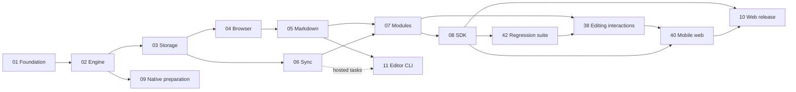

# edit.ac architecture and development roadmaps

[Shared editor, GitHub and website styling](design/brand-guide.md)

This repository defines a Rust-first editor SDK for web, native iOS, Android, macOS, Windows and Linux, with a separate CLI/TUI client. It contains 42 roadmap files and 570 bounded parent tasks. These are development contracts, not claims of shipped capability; implementation status belongs in the runner’s separate progress and qualification evidence.

The user selected public repositories and Apache-2.0. [Decision 001](decisions/001-web-first.md) resolves scope, ownership, naming and release conflicts. [Decision003](decisions/003-extension-ecosystem.md) adds the requested extension, format, cloud and public-documentation delivery. The [original proposal](sources/initial-roadmap.md) is archived unchanged as reference material; current specs and task acceptance supersede it. [Decision 002](decisions/002-full-delivery.md) extends delivery beyond the initial browser release; the [requirement review](requirements.md) maps each requested capability to concrete tasks.

## Extension integration and authoring

The existing [SDK](roadmaps/08-sdk-integration.md), [extension library](roadmaps/21-extension-library.md) and [architecture fitness](roadmaps/30-architecture-fitness.md) roadmaps add 12 follow-up parents for one-import extension configuration, managed lazy bundles/assets, an approachable custom extension API, verified ASD-123 task linking, spellcheck, custom parsing/URL insertion, compressed delivery and measured SDK/WASM reductions. [The contract](specs/extension-dx.md) makes individual extension composition primary; optional default/document presets are convenience configurations, and application use cases do not prescribe feature sets. Existing Task budget/compatibility evidence remains intact. [The case catalog](tests/extension-dx-cases.md) defines 32 planned outcomes. Public extension catalog/tutorial tasks consume the resulting canonical SDK recipes. The Tiptap-informed review tightens those same parents for configurable basic formatting, optional per-editor collaboration/presence, indexed hot-path dispatch and workload-specific JS/WASM latency checks; see the [review basis](specs/extension-dx.md#review-basis--2026-10-17) and [performance contract](specs/verification.md#extension-dispatch-and-jswasm-performance). No roadmap or parent is added by this review. This planning amendment starts no runner and makes no new capability, size or speed claim.

The [platform editing policy](specs/platform-editing-services.md) and [twelve ENV acceptance variants](tests/platform-editing-cases.md) refine these existing owners: prefer user-respecting platform spellcheck, expose off/custom modes, keep autocorrection separate, and reuse native input/command/accessibility facilities with one shared semantic history. SDK-1.11, EXT-1.18, browser interaction and native input/command/qualification parents consume the added acceptance. This 2026-10-17 amendment adds no roadmap/parent, changes no active runner snapshot and makes no runtime-support claim; adoption occurs at the existing coordinator’s safe source-refresh checkpoint.

## Start here

Follow [workspace setup](WORKSPACE_SETUP.md) to clone the sibling repositories, select their toolchains and install [ROOT_AGENTS.md](ROOT_AGENTS.md) as `AGENTS.md` in the workspace root. Keep the version-controlled root rules in this repository and sync the parent copy after updates.

Clone [core](https://github.com/edit-ac/core), this repository as `architecture`, optional [cli](https://github.com/edit-ac/cli), and [public docs](https://github.com/edit-ac/docs) into one parent directory. The parent itself is not a Git repository. Read the active task's named context rather than every document.

1. Check [setup evidence](evidence/setup.md), [dependency verification](evidence/dependencies.md) and the [full-delivery review](evidence/requirements-review.md).
2. Read [runner operation](operations/roadmap-runner.md), then the selected roadmap's entry gate.
3. Validate all sources with `npm ci --ignore-scripts` and `npm run check` in this repository. These commands do not execute workers or make inference calls.
4. Resume the designated runner using its recorded progress and immutable task source. Do not start a duplicate controller in an active checkout. Workers execute at most one parent per iteration; source checkboxes remain a template, not live progress.

## Platform qualification policy

The user approved simulators, emulators and desktop OS VMs/test hosts for full platform and release qualification on 2026-10-14. Physical hardware is optional. Required implemented behavior, current-artifact case coverage and performance checks still pass in the declared runtime; unavailable hardware-only observations use documented tested virtual equivalents. Preserve physical/virtual provenance and historical evidence. See the [authoritative policy](specs/verification.md#platform-qualification-with-simulators-emulators-and-vms).

## Milestones and task tracks

| Track | Parent tasks | Required upstream tracks | Exit artifact |
|---|---:|---|---|
| [01 Foundation](roadmaps/01-foundation.md) | 14 | Project scaffold | Pinned interop/offset/schema and compiled WASM proof |
| [02 Engine](roadmaps/02-engine.md) | 23 | 01 | Qualified block/ownership/structural profiles, deterministic semantic commands, anchors, history and patches |
| [03 Local storage](roadmaps/03-local-storage.md) | 7 | 02 | Crash-tested journal/checkpoint/outbox recovery |
| [04 Browser input](roadmaps/04-browser-input.md) | 14 | 02, 03 | Qualified input protocol and heading-end command, continuous accessible editing and composition lifecycle |
| [05 Markdown/content](roadmaps/05-markdown-content.md) | 15 | 02, 04 | Tested dialect, safe paste, round trips and source reconciliation |
| [06 Synchronization](roadmaps/06-synchronization.md) | 7 | 02, 03 | Direct wire exchange, reconnect and explicit durable receipts |
| [07 Modules](roadmaps/07-extension-modules.md) | 9 | 05, 06 | Portable extensions and optional browser interactions |
| [08 SDK integration](roadmaps/08-sdk-integration.md) | 9 | 04–07 | Framework-independent SDK, first-party React/Astro integrations, shared engine/assets across configurations and routes, packed consumers and integration/recovery examples |
| [09 Native preparation](roadmaps/09-native-preparation.md) | 7 | 02 | Swift/Kotlin and native control probes; follow-up scope |
| [10 Web qualification](roadmaps/10-web-qualification.md) | 9 | 08, 38, 40 | Default Task gzip caps, measured browser support, recovery and vetted prerelease |
| [11 Editor CLI](roadmaps/11-offline-cli.md) | 12 | 02, 05; hosted tasks also 06 | Local Markdown/text editing, recovery and hosted sync |

Milestone A: foundation and semantic kernel (01–02). Milestone B: durable browser editing (03–04). Milestone C: everyday content and collaboration (05–06). Milestone D: extensible consumable SDK (07–08). Milestone E: browser release qualification (10). Native preparation (09) and the local-first editor client (11) are independent delivery branches, not browser release prerequisites.

## Full-delivery follow-ups

The initial browser milestone remains independently deliverable. These tracks complete the broader product; the optional encrypted profile has its own release gate. Track numbers identify documents, not a required numerical execution order.

| Track | Parent tasks | Required upstream tracks | Exit artifact |
|---|---:|---|---|
| [12 Shared client contracts](roadmaps/12-client-contracts.md) | 10 | 02,03,05,06 | Portable sessions, stores, identity, revisions and edit policy |
| [13 Exact change review](roadmaps/13-change-diffs.md) | 8 | 12 | Immutable revisions, source/semantic diffs and checked hunk application |
| [14 Host-app MCP editing](roadmaps/14-host-agent-editing.md) | 7 | 08,12,13,21 | Markdown upload/preview/apply, durable retries and realtime observation |
| [15 Built-in TUI](roadmaps/15-tui-client.md) | 12 | 11,12,13 | Terminal editing of local and hosted documents with diff review |
| [16 Native iOS SDK](roadmaps/16-ios-sdk.md) | 22 | 07,12,13,21; iOS preparation evidence | Packaged native editor and capability matrix |
| [17 Native Android SDK](roadmaps/17-android-sdk.md) | 22 | 07,12,13,21; Android preparation evidence | Packaged native editor and capability matrix |
| [18 Native macOS SDK](roadmaps/18-desktop-native.md) | 22 | 07,12,13,21 | AppKit editor and packaged consumer |
| [19 Optional document protection](roadmaps/19-security-encryption.md) | 10 | 12,13,21 | Protected storage, ciphertext transport and key lifecycle |
| [20 Full client qualification](roadmaps/20-product-scenarios.md) | 10 | 08,10,13–18,21–23 | PM tickets, collaboration, agents and actual platform evidence |
| [21 First-class extension library](roadmaps/21-extension-library.md) | 13 | 05,07,12 | Portable descriptors, presenters, conformance and package consumers |
| [22 Native Windows SDK](roadmaps/22-windows-native.md) | 22 | 07,12,13,21 | Windows native editor and packaged consumer |
| [23 Native Linux SDK](roadmaps/23-linux-native.md) | 22 | 07,12,13,21 | GTK native editor and packaged consumer |
| [24 Encrypted profile qualification](roadmaps/24-encrypted-profile-qualification.md) | 13 | 19,20,25–28,31–36 | Real key providers, protected scenarios and independent review |

## Extension and public ecosystem delivery

[Review and corrections](evidence/extension-ecosystem-review.md) distinguish existing baseline modules from the new work. Each platform integration is independent. Documentation bootstrap has no SDK gate; runnable examples and the public demo require their task-specific qualified artifacts.

| Track | Parent tasks | Whole-track prerequisites | Exit artifact |
|---|---:|---|---|
| [25 Rich content and AI](roadmaps/25-rich-content-extensions.md) | 37 | 05, 07, 12, 13, 21 | Code highlighting, tables, assets/embeds, interactions and optional AI writing |
| [26 Public and internal links](roadmaps/26-link-resolution.md) | 12 | 12, 21 | Automatic metadata, permission-scoped references and safe activation |
| [27 Document formats](roadmaps/27-document-conversion.md) | 18 | 05, 12, 21, 25 | Direction/fidelity profiles; PDF export only |
| [28 Cloud-store readiness](roadmaps/28-cloud-document-store.md) | 21 | 06, 12, 25 | Durable reference service, tenant isolation, assets and recovery |
| [29 Public docs and demo](roadmaps/29-public-docs-demo.md) | 25 | None; task-specific gates | Concepts/API/extensions, concrete examples, comparisons and a deployed editor |
| [30 Architecture fitness](roadmaps/30-architecture-fitness.md) | 9 | 08, 12, 21 | Layer/capability/compatibility/loading/privacy checks |
| [31 iOS extensions](roadmaps/31-ios-extension-integration.md) | 9 | 16, 25, 26, 27, 30 | Native feature wiring and packaged consumer evidence |
| [32 Android extensions](roadmaps/32-android-extension-integration.md) | 9 | 17, 25, 26, 27, 30 | Native feature wiring and packaged consumer evidence |
| [33 macOS extensions](roadmaps/33-macos-extension-integration.md) | 9 | 18, 25, 26, 27, 30 | Native feature wiring and packaged consumer evidence |
| [34 Windows extensions](roadmaps/34-windows-extension-integration.md) | 9 | 22, 25, 26, 27, 30 | Native feature wiring and packaged consumer evidence |
| [35 Linux extensions](roadmaps/35-linux-extension-integration.md) | 9 | 23, 25, 26, 27, 30 | Native feature wiring and packaged consumer evidence |
| [36 CLI/TUI extensions](roadmaps/36-terminal-extension-integration.md) | 6 | 15, 25, 26, 27, 30 | Terminal code/table/assets/links and format actions |
| [37 Expanded qualification](roadmaps/37-ecosystem-qualification.md) | 9 | 20, 25, 26, 27, 28, 30, 31, 32, 33, 34, 35, 36, 39, 41 | Actual cross-client scenarios, docs/demo and release evidence |

The machine-readable dependency graph is [manifest.json](roadmaps/manifest.json). Its edges are whole-track entry conditions, not a multi-runner scheduler. Roadmaps 16 and 17 require only their platform-specific NAT preparation tasks, not all of 09. Roadmap 11 additionally gates hosted tasks on track 06; its local editing tasks can proceed without hosted readiness. Launching parallel workers in one checkout is unsupported; use isolated worktrees and explicit integration ownership if later concurrency is needed.

## Contract map

- [Engine](specs/engine.md): state ownership, prepared mutation, anchors, history and schema spike.
- [Browser](specs/web.md): DOM, IME, loading, selection and disposal.
- [Formats](specs/formats.md): CommonMark/GFM profile, fallback, safe import and export.
- [Storage/sync](specs/storage-sync.md): local commit, journal, receipts, recovery and protocol.
- [Modules/native](specs/modules-native.md): extensibility, optional UI and native preparation.
- [CLI](specs/cli.md): local Markdown/text editing, configured editor, source reconciliation, recovery and hosted documents.
- [Shared clients](specs/client-contracts.md), [change review](specs/change-diffs.md) and [host agents](specs/agent-editing.md): portable services and safe concurrent edits.
- [Native parity](specs/native-sdk-parity.md), [TUI](specs/tui-client.md) and [extension library](specs/extension-library.md): client-specific delivery without duplicating the semantic core.
- [Security profiles](specs/security-encryption.md) and [delivery scenarios](specs/delivery-scenarios.md): optional encryption and concrete cross-platform acceptance.
- [Rich content](specs/rich-content-extensions.md), [link resolution](specs/link-resolution.md) and [document conversion](specs/document-conversion.md): optional first-party services.
- [Cloud store](specs/cloud-document-store.md), [public docs/demo](specs/public-docs-demo.md) and [maintainability](specs/ecosystem-maintainability.md): ecosystem ownership and qualification.
- [Packages/release](specs/packages-release.md): package ownership, artifacts, publishing and CLI.
- [Verification](specs/verification.md): evidence, supported envelope and provisional budgets.

The foundation produces `schema-v1.md` and `protocol-v1.md` only after adversarial probes. They are development outputs; production schema decisions must not be invented to make a task appear complete.

## Everyday typing and assistive input

[Research](evidence/editor-interaction-research.md) draws on ProseMirror/Tiptap, Lexical, Slate and their documented regressions; [assistive research](evidence/assistive-input-research.md) adds platform and accessibility sources. [The behavior contract](specs/editor-interactions.md) and [targeted case catalog](tests/editor-interaction-cases.md) specify Enter/Shift+Enter, selected formatting, deletion, whitespace/Unicode, keyboard/selection, slash controls, parsing and paste. These are planned acceptance requirements, not shipped support.

| Track | Parent tasks | Whole-track prerequisites | Exit artifact |
|---|---:|---|---|
| [38 Everyday editing](roadmaps/38-editor-interactions.md) | 18 | 04, 05, 07, 42 | Deterministic regression corpus and real input/accessibility evidence; required by 10 |
| [39 Assistive input](roadmaps/39-assistive-input.md) | 11 | 38, 21; native/TUI gates per task | Optional portable assistance extension and independent platform evidence; required by 37 |

Baseline keyboard access, screen-reader editing and OS dictation work without the optional extension. Assistance adds discoverable commands, status and explicit host capabilities, with prepared/mock transports in automated tests. No speech provider or paid inference testing is added. Existing engine work and its progress remain independently owned; these roadmap edits do not start another runner.

## Touch devices and mobile browser support

[Mobile web](specs/mobile-web.md) defines a small shared semantic core, mandatory touch/mobile browser behavior, progressive keyboard/browser APIs and optional extension presenters. [Platform research](evidence/mobile-web-platform-research.md) and [touch research](evidence/touch-extension-research.md) provide current primary sources and scoped upstream regressions. The catalogs add [64 baseline cases](tests/mobile-web-cases.md) and [32 extension cases](tests/mobile-extension-cases.md), all planned rather than executed support claims.

| Track | Parent tasks | Whole-track prerequisites | Exit artifact |
|---|---:|---|---|
| [40 Mobile web](roadmaps/40-mobile-web.md) | 11 | 08, 38 | Touch/keyboard/viewport/API fallback and physical or virtual platform evidence; required by 10 |
| [41 Mobile extensions](roadmaps/41-mobile-web-extensions.md) | 9 | 40, 25, 26, 27, 30; web assistance gates per task | Touch-accessible rich presenters, capability fallbacks and measured optional costs; required by 37 |

Browser release qualification uses [gzip bundle budgets](specs/verification.md#browser-bundle-size-budgets): 512 KiB total / 32 KiB editor JS hard caps, with 256 KB total / 16 KB editor JS preferred sizes (KB = 1,000 bytes). Required WASM glue, runtime dependencies and lazy required code count toward the caps.

Mobile baseline support does not load optional rich-content, converter, gesture or assistance packages. The proposed incremental baseline JS allowance is 5 KB gzip within the 32 KiB JS hard cap, with event-driven idle behavior and bounded geometry work. Exact costs and support require real measurements; browser API presence alone is insufficient.

## Editing regression suite

[Further regression research](evidence/editor-regressions-round2.md) and [upstream testing methods](evidence/editor-testsuite-methods.md) inform the [suite and architecture guards](specs/editing-regression-suite.md). The [machine-readable manifest](tests/editing-suite/suite.json) indexes 324 catalog cases, 14 guards and 14 representative recipes with 45 independently authored state/effect checkpoints. [Seventeen additional cases](tests/editor-regression-cases.md) target history capture/grouping, atomic edits, normalization, nested controls, custom views and widget selection.

| Track | Parent tasks | Whole-track prerequisite | Exit artifact |
|---|---:|---|---|
| [42 Editing regression suite](roadmaps/42-editing-regression-suite.md) | 8 | 08 | Shared real-engine drivers, guard sensitivity and honest coverage reports; required by 38 |

`npm run check` now validates roadmap/fixture consistency and runs the planning-validator contract tests. Those tests do not execute the editing recipes or prove browser support. Track 42 and the existing feature/device owners provide that evidence. The test harness adds no runtime dependency to the editor.

## Desktop conventions and official configurations

[Desktop research](evidence/desktop-editing-research.md), [native protocol research](evidence/native-editing-research.md) and [extension/performance research](evidence/editing-performance-extension-research.md) deepen the existing plan without adding a roadmap. The [77 additional cases](tests/desktop-editing-cases.md) cover selection gestures and replacement, text move/copy, native command surfaces, bounded find/replace, code conveniences, table selections, supported first-party presets and mixed-feature performance. Seven bounded parents extend tracks 21, 25 and 38; existing native/mobile, architecture and qualification owners take the related cases. Those desktop additions kept the plan at 42 roadmap files; the AI work below is consolidated into roadmap 25. Feature contracts and source checks are not implementation or performance qualification. The [integration record](evidence/desktop-interactions/README.md) records scope, validation and limits.

## AI extensions

[The AI contract](specs/ai-extensions.md) adds the missing writing operations; [research and suggestions](evidence/ai-extension-research.md) record Tiptap references and existing coverage. Track 39 already owns assistance lifecycle patterns, track 13 owns proposal review, and track 14 owns host-app MCP edits. These foundations do not already promise in-editor AI writing.

| Track | Parent tasks | Whole-track prerequisites | Exit artifact |
|---|---:|---|---|
| [25 AI epic](roadmaps/25-rich-content-extensions.md#epic-rch-2--deliver-optional-ai-writing-through-existing-edit-contracts) | 14 of 36 | Existing 25 gates; AI-only 08, 38, 40 and per-task native/TUI/docs gates | Ask AI, fill/continue, selected-text actions and opt-in autocomplete; mock-backed consumers and independent platform evidence |

Deliver explicit Ask AI/fill and selected-text actions first, then bounded autocomplete. AI uses optional host-owned transports, explicit context and request limits, transient previews and reviewed semantic edits. Vercel AI SDK Core is the default TypeScript host/backend adapter, qualified with pinned stable versions and prepared mocks through the same portable transport; editor consumers may provide another conforming host transport. It adds no baseline release gate or mandatory provider dependency. Prepared responses qualify integration only; no paid inference or live dogfood is authorized. Additional first-party candidates include glossary checks, notes-to-checklists, source-referenced explanations, reusable templates and anchored review comments; these remain suggestions, not committed tasks.

## Shared resources across editors and site routes

The [browser sharing contract](specs/web.md#shared-resources-across-editors-and-site-routes) covers task-description/comment editors on one page and task-description/document configurations across one site. Two bounded additions to existing roadmap 08, SDK-1.9/1.10, preserve instance state while sharing compatible runtime/static assets, then qualify packed common chunks and client/full-navigation cache behavior. Existing tracks 10/20/21/29/30 consume the same SHR-01–SHR-08 evidence for loading, configuration isolation, performance and guides. This adds no roadmap file or runtime service. Earlier module-local initialization/multiple-instance evidence remains useful but does not qualify the added site matrix; adopt at a safe controller source-refresh checkpoint without rewriting progress or restarting active workers.

## Clipboard format and device follow-ups

[Native clipboard cases](tests/native-clipboard-cases.md) define 28 future cases for simulator/emulator/OS-host regression and separately recorded physical-device qualification. Native SDK track tasks 2.4 feed the handoffs; DEL-1.9/DEL-1.10 gate real mobile/desktop transfer qualification. FMT-1.13 owns full Markdown/HTML/plain/internal palette integration; FMT-1.15 preserves its actual-device clipboard-menu and OS-shortcut qualification gate and EXT-1.13 plus native extension tasks 1.9 own formatting-preserving tables and other extension content. No native tests were run by authoring these plans.

Content migrations and editor migration guides are [deferred until full app completion and qualification](operations/deferred-content-migrations.md). Their preserved tasks are outside the active runner catalog.

## Wordcraft reliability and converter refinements

[Source research and overlap](evidence/wordcraft-research.md) adds [19 planned cases](tests/wordcraft-regression-cases.md) to the existing suite and refines eight existing case variants. Priorities are failure paths, converter qualification, then cache/command checks. Existing parent owners receive the acceptance and validation changes; roadmap, parent and dependency counts stay unchanged. No runtime execution, new format direction, dependency, general layout engine or offline proofing feature is claimed. Adopt at a safe controller checkpoint without rewriting active progress or treating earlier receipts as proof of the new assertions.
