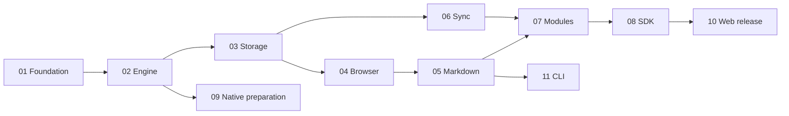

# edit.ac architecture and development roadmaps

This repository turns the initial proposal into a Rust-first browser editor plan with a separate native preparation track. It contains 11 roadmap files and 102 bounded parent tasks. Development has not been run: checked scaffolding and candidate dependency facts are distinct from editor qualification.

The user selected public repositories and Apache-2.0. [Decision 001](decisions/001-web-first.md) resolves scope, ownership, naming and release conflicts. The [original proposal](sources/initial-roadmap.md) is archived unchanged as reference material; current specs and task acceptance supersede it.

## Start here

Clone [core](https://github.com/edit-ac/core), this repository as `architecture`, and optional [cli](https://github.com/edit-ac/cli) into one parent directory. The parent itself is not a Git repository. Read the active task's named context rather than every document.

1. Check [setup evidence](evidence/setup.md) and [dependency verification](evidence/dependencies.md).
2. Read [runner operation](operations/roadmap-runner.md), then the selected roadmap's entry gate.
3. Validate all sources with `npm ci --ignore-scripts` and `npm run check` in this repository. These commands do not execute workers or make inference calls.
4. Start with roadmap 01 only when intentionally beginning development. A design request does not launch a runner. Workers record separate progress and execute at most one parent per iteration.

## Milestones and task tracks

| Track | Parent tasks | Required upstream tracks | Exit artifact |
|---|---:|---|---|
| [01 Foundation](roadmaps/01-foundation.md) | 14 | Project scaffold | Pinned interop/offset/schema and compiled WASM proof |
| [02 Engine](roadmaps/02-engine.md) | 15 | 01 | Deterministic semantic commands, anchors, history and patches |
| [03 Local storage](roadmaps/03-local-storage.md) | 7 | 02 | Crash-tested journal/checkpoint/outbox recovery |
| [04 Browser input](roadmaps/04-browser-input.md) | 12 | 02, 03 | Continuous accessible editing and composition lifecycle |
| [05 Markdown/content](roadmaps/05-markdown-content.md) | 11 | 02, 04 | Named tested dialect, safe paste and round-trip diagnostics |
| [06 Synchronization](roadmaps/06-synchronization.md) | 7 | 02, 03 | Direct wire exchange, reconnect and explicit durable receipts |
| [07 Modules](roadmaps/07-extension-modules.md) | 9 | 05, 06 | Portable extensions and optional browser interactions |
| [08 SDK integration](roadmaps/08-sdk-integration.md) | 6 | 04–07 | Packed SDK consumers, React wrapper and scoped migration |
| [09 Native preparation](roadmaps/09-native-preparation.md) | 7 | 02 | Swift/Kotlin and native control probes; follow-up scope |
| [10 Web qualification](roadmaps/10-web-qualification.md) | 9 | 08 | Measured browser support, recovery and vetted prerelease |
| [11 Offline CLI](roadmaps/11-offline-cli.md) | 5 | 02, 05 | Versioned offline validation/conversion/inspection |

Milestone A: foundation and semantic kernel (01–02). Milestone B: durable browser editing (03–04). Milestone C: everyday content and collaboration (05–06). Milestone D: extensible consumable SDK (07–08). Milestone E: browser release qualification (10). Native preparation (09) and offline tooling (11) are independent delivery branches, not browser release prerequisites.

The machine-readable dependency graph is [manifest.json](roadmaps/manifest.json). Its edges are entry conditions, not a multi-runner scheduler. Launching parallel workers in one checkout is unsupported; use isolated worktrees and explicit integration ownership if later concurrency is needed.

## Contract map

- [Engine](specs/engine.md): state ownership, prepared mutation, anchors, history and schema spike.
- [Browser](specs/web.md): DOM, IME, loading, selection and disposal.
- [Formats](specs/formats.md): CommonMark/GFM profile, fallback, safe import and export.
- [Storage/sync](specs/storage-sync.md): local commit, journal, receipts, recovery and protocol.
- [Modules/native](specs/modules-native.md): extensibility, optional UI and native preparation.
- [Packages/release](specs/packages-release.md): package ownership, artifacts, publishing and CLI.
- [Verification](specs/verification.md): evidence, supported envelope and provisional budgets.

The foundation produces `schema-v1.md` and `protocol-v1.md` only after adversarial probes. Their planned absence now is intentional; production schema decisions must not be invented to make a task appear complete.
