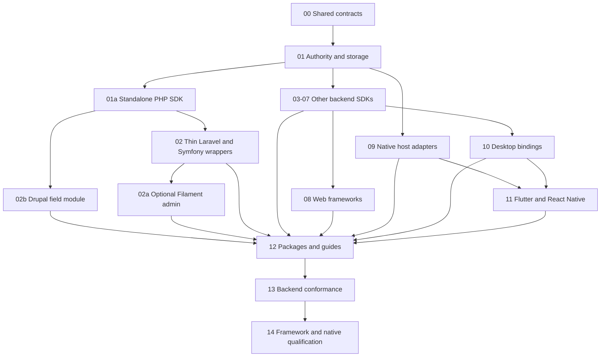

# Backend SDK and framework adapter delivery plan

Status: PLANNED. User scope: 2026-10-24. 18 focused roadmap files, 130 unfinished parent tasks. This index is controller-owned and is not a worker queue entry. [Authoritative contract](../../specs/backend-sdk-adapters.md).

## Intended developer experience

Install the matching editor/framework binding and backend adapter; configure application authorization, durable storage and the explicit Rust validation/authority topology; create, edit, save and reopen without implementing the protocol. The standalone PHP SDK comes first; Laravel is a thin wrapper and Filament admin is an optional wrapper above Laravel, and Drupal is a separate field module over the PHP SDK. Checkpoint persistence, live collaboration and server semantic operations are separately declared capabilities. Every package preserves one current document identity and the same save/receipt rules.

Pre-alpha clarification, 2026-10-24: the one current schema is `editac.registry.editor` and profile is `editac.yrs-yjs.editor`. No `.v5` suffix, legacy aliases, parallel format implementations or previous/current SDK matrices are required. Real protocol/codec/ABI discriminators remain validated with one supported value. BSC-1.1 records the existing core/Session identity-cutover owner; BSC-1.7 requires actual unversioned creation/restore/sync/FFI fixture evidence before dependent SDK acceptance. Original stored bytes remain preserved; no automatic relabel or active queue edit is authorized.

## Scope and order

Packaging follow-up, 2026-10-26: [dedicated integration repositories/packages and registry listings](../../specs/integration-distribution.md) supersede permanent core-relative placement. Feature/task IDs and current sources remain intact. At a safe checkpoint, reconcile completed work and prepare bounded per-integration extraction/packaging sources with BPG-1.5/1.6 handoffs. Do not treat in-core feature completion as extraction, listing readiness or publication, or edit an active worker's immutable source to perform the move.

Planning does not start/enqueue a runner or change the active source snapshot. Preserve current web → features → alpha → native → docs → qualification → native tests → beta → integrations sequencing. This is an additive integration expansion outside the 43-track manifest; track counts/dependencies are unchanged. Existing native tracks still own their engine/surface work. Adopt these sources only at the coordinator's safe checkpoint using the existing guard and live readiness receipt, with one root controller and the relevant prerequisite evidence. Package names/runtime ranges are settled before coding examples; a planned row is not shipped support.

The serial queue below is a proposed future order, not a dependency on every preceding language. Each file names targeted entry artifacts and local parent dependencies. A blocked queue entry holds later entries; the controller may explicitly construct a different ready subset at a safe checkpoint, but must not hide a blocked capability or auto-retry unchanged input. Do not put unavailable native/release work in front of independent ready backend delivery. No execution command or schedule is created by this document.

| Order | Focused source | Prefix | Parents | Separate progress path (architecture-relative, ignored) |
|---|---|---|---:|---|
| 1 | [00-contracts](00-contracts.md) | BSC | 8 | `.roadmap-runner/backend-sdk-adapters-20261024/00-contracts.progress.md` |
| 2 | [01-authority-and-storage](01-authority-and-storage.md) | BAS | 8 | `.roadmap-runner/backend-sdk-adapters-20261024/01-authority-and-storage.progress.md` |
| 3 | [01a-php-sdk](01a-php-sdk.md) | BPH | 6 | `.roadmap-runner/backend-sdk-adapters-20261024/01a-php-sdk.progress.md` |
| 4 | [02-php-laravel-symfony](02-php-laravel-symfony.md) | BPH | 5 | `.roadmap-runner/backend-sdk-adapters-20261024/02-php-laravel-symfony.progress.md` |
| 5 | [02a-filament-admin](02a-filament-admin.md) | BFA | 5 | `.roadmap-runner/backend-sdk-adapters-20261024/02a-filament-admin.progress.md` |
| 6 | [02b-drupal-fields](02b-drupal-fields.md) | BDR | 9 | `.roadmap-runner/backend-sdk-adapters-20261024/02b-drupal-fields.progress.md` |
| 7 | [03-typescript-node](03-typescript-node.md) | BTS | 8 | `.roadmap-runner/backend-sdk-adapters-20261024/03-typescript-node.progress.md` |
| 8 | [04-python](04-python.md) | BPY | 7 | `.roadmap-runner/backend-sdk-adapters-20261024/04-python.progress.md` |
| 9 | [05-go-rust](05-go-rust.md) | BGR | 8 | `.roadmap-runner/backend-sdk-adapters-20261024/05-go-rust.progress.md` |
| 10 | [06-jvm-dotnet](06-jvm-dotnet.md) | BJD | 8 | `.roadmap-runner/backend-sdk-adapters-20261024/06-jvm-dotnet.progress.md` |
| 11 | [07-ruby-c-cpp](07-ruby-c-cpp.md) | BRC | 7 | `.roadmap-runner/backend-sdk-adapters-20261024/07-ruby-c-cpp.progress.md` |
| 12 | [08-web-frameworks](08-web-frameworks.md) | BWF | 8 | `.roadmap-runner/backend-sdk-adapters-20261024/08-web-frameworks.progress.md` |
| 13 | [09-apple-android](09-apple-android.md) | BNA | 8 | `.roadmap-runner/backend-sdk-adapters-20261024/09-apple-android.progress.md` |
| 14 | [10-desktop-hosts](10-desktop-hosts.md) | BDH | 8 | `.roadmap-runner/backend-sdk-adapters-20261024/10-desktop-hosts.progress.md` |
| 15 | [11-flutter-react-native](11-flutter-react-native.md) | BCP | 6 | `.roadmap-runner/backend-sdk-adapters-20261024/11-flutter-react-native.progress.md` |
| 16 | [12-packages-and-guides](12-packages-and-guides.md) | BPG | 6 | `.roadmap-runner/backend-sdk-adapters-20261024/12-packages-and-guides.progress.md` |
| 17 | [13-final-backend-testing](13-final-backend-testing.md) | BFT | 7 | `.roadmap-runner/backend-sdk-adapters-20261024/13-final-backend-testing.progress.md` |
| 18 | [14-final-framework-native-testing](14-final-framework-native-testing.md) | BNT | 8 | `.roadmap-runner/backend-sdk-adapters-20261024/14-final-framework-native-testing.progress.md` |

All checks start from the core root unless stated otherwise. `scripts/sdk-adapter-delivery.mjs` and its selectors are planned interfaces created/registered by the named tasks, not commands asserted to exist today. Before BSC-1.7, direct contract inspection/lint provides focused evidence. The initial tiny prepared binary/receipt oracle is justified by cross-language data-loss risk; comprehensive test development and all full matrices are reserved for files 13 and 14, after all functional files. Final test files are required for whole-plan completion.

## Dependency graph and handoff evidence

The graph groups families for readability; exact file entries are authoritative. In particular, web frameworks consume BTS-1.8, desktop C/C++ consumes BRC-1.5/1.6, and Flutter desktop consumes only the matching supported native surface. Native UI tasks additionally require actual existing track 09/16/17/18/22/23 exports; a transport-only client can proceed without its renderer. Targeted current source paths, accepted selectors/results and missing-interface ownership are recorded in each predecessor's ignored progress file; source Status and queue position are insufficient proof.

PHP ownership is split deliberately: BPH-1.1/1.2/1.5/1.9–1.11 belong to the standalone SDK file; BPH-1.3/1.4/1.6–1.8 remain Laravel/Symfony wrappers; BFA owns only Filament UI/lifetime glue. Existing IDs are preserved. MySQL/MariaDB behavior and all save/retry/receipt algorithms are SDK-owned, while Laravel maps its actual connection/transaction. Filament uses the Laravel wrapper and real browser SDK; Drupal BDR-1.1–1.9 depends directly on the PHP SDK and provides field type/widget/formatter with revision-pinned references. Neither base package requires these optional CMS/admin integrations. Drupal needs no Laravel or Filament.

Core-relative paths under `sdk/`, `adapters/` and `examples/sdk-adapters/` are planned boundaries reconciled to existing packages in BSC-1.1. Reuse existing engine, Session, web, native and track 28 ports; repair a missing shared API with its owner. Do not create an independent CRDT, database authority, renderer or compatibility alias for an adapter. Framework-owned database and delegated Rust authority are alternative explicit topologies with one commit/receipt owner.

## Language and framework coverage

| Requirement / family | Functional owner | Planned delivered integration |
|---|---|---|
| Common contracts and storage | 00, 01 | Checkpoint CAS, current-format validation, append/resume/receipt lookup, real SQLite/PostgreSQL, optional assets/lifecycle |
| PHP | 01a, 02, 02a, 02b | Standalone Composer SDK and PDO profiles; thin Laravel/Eloquent and Symfony/Doctrine wrappers; optional Filament custom field/admin example and Drupal document field/widget/formatter module; separately qualified MySQL and MariaDB |
| TypeScript / JavaScript | 03 | Node client, Express/Fastify/NestJS, SQL ports, Next.js route handlers, browser save orchestration |
| Python | 04 | Sync/async client, Django/DRF, FastAPI/Starlette, SQLAlchemy |
| Go | 05 | Context-aware client, database/sql, net/http, Gin, Echo |
| Rust | 05 | Existing semantic/authority facade, Axum host |
| Java / Kotlin JVM | 06 | Java HTTP client, Kotlin coroutines, Spring Boot/Security/JDBC, Ktor |
| C# / .NET backend | 06 | Async client, ASP.NET Core, EF Core |
| Ruby | 07 | Gem client, Rails/ActiveRecord |
| C / C++ | 07 | Explicit ABI ownership, headless checkpoint/semantic hooks and C++ RAII wrapper |
| Web frameworks | 08 | Existing React/Astro plus Next.js, Vue/Nuxt, Svelte/SvelteKit, Angular; form/SSR/lifetime recipes |
| Swift / Apple | 09 | Existing native engine facade, UIKit/SwiftUI, AppKit/SwiftUI; offline/background recovery |
| Kotlin / Android | 09 | Coroutine facade, native Views/Compose and restoration hooks |
| Windows / Linux | 10 | .NET native bridge, existing WinUI/GTK host integration, WPF interop wrapper |
| Desktop shells and Qt | 10 | Electron/Tauri browser hosts; Qt C++ headless client and bounded native GUI feasibility decision |
| Dart / Flutter | 11 | Typed authority client and native platform-view bridge/widget for supported surfaces |
| React Native | 11 | Swift/Kotlin native module and native editor component; no WebView fallback |
| Local distributions and adoption | 12 | Installable local packages, notices, per-family guides and authored capability register |

Qt GUI rendering, additional databases/frameworks beyond these rows, encrypted server semantics and full content migration are not silently committed. Qt GUI requires a concrete supported host decision and additional scoped work; protected support requires tracks 19/24 and its own evidence. Existing editor-content migration deferrals remain intact. A requested future addition gets a named owner and targeted tasks rather than an unconditional support badge.

## One final owner per acceptance family

| ID | Required outcome | Functional anchors | Final testing owner |
|---|---|---|---|
| B01 | Exact canonical identity/bytes, initialized-empty, Unicode/unknown data, unsupported-input rejection | BSC-1.2/1.7, each language codec | BFT-1.2 |
| B02 | Real transactional save/reopen, binary storage, CAS, rollback/restart and correct durability | BAS-1.3–1.6, SDK BPH-1.9/1.5 and Laravel BPH-1.4, language repositories | BFT-1.3 |
| B03 | Stable operation identity, deduplication, commit-unknown, cancellation and retry floors | BSC-1.4, client commit tasks | BFT-1.4 |
| B04 | Tenant/policy/read-only enforcement, limits, semantic bridge/CAS race safety | BSC-1.5, BAS-1.1/1.2, framework policy tasks | BFT-1.5 |
| B05 | Optional collaboration, same-authority mode transition, outbox/compaction, separate asset receipts | BSC-1.4, BAS-1.7/1.8, PHP BPH-1.10 and thin collaboration bindings | BFT-1.6 |
| B06 | Honest runtime/database/package capabilities and outstanding backend release/security claims | BSC-1.8, BPG-1.6 | BFT-1.7 |
| H01 | SSR isolation, stable mount/hydration/form/reset/navigation, multiple independent editors and Filament/Livewire forms/modals | BWF-1.1–1.8, BFA-1.1–1.5 | BNT-1.2 |
| H02 | Actual native surface, composition/selection/history/accessibility and stable widget/session ownership | BNA, BDH-1.1–1.4, BCP | BNT-1.3 with exact track 43 observation handoff |
| H03 | Offline/background/process recovery and honest local/remote status | BNA-1.8, BDH-1.8, BCP-1.6 | BNT-1.4 |
| H04 | IPC/ABI ownership and actual local distribution consumers | BRC-1.4–1.7, BDH-1.5–1.7, BPG-1.5 | BNT-1.5 |
| H05 | Resource teardown, optional-loading overhead and unchanged final hard caps | All lifecycle bindings | BNT-1.6; applicable existing cap owners retain their gates |
| H06 | Complete host runtime matrix and explicit unqualified/unsupported dispositions | BPG-1.6, BNT-1.1 | BNT-1.7 |
| H07 | Drupal field/config semantics, revision-pinned snapshots, translations/moderation, AJAX lifetimes, safe formatter/cache/access and reference cleanup | BDR-1.1–1.9; SDK BPH-1.9 snapshot ports | BNT-1.8 |

BFT-1.1 and BNT-1.1 organize remaining case development and reuse; Drupal-specific field/entity/cache cases belong only to BNT-1.8 and reuse BFT primitive results; they do not duplicate the owners above. Final backend and host qualification are both mandatory. Actual simulator/emulator/OS-host cases are added to track 43's observation register and executed there/through its accepted harness; a mock or successful compile does not replace them. No claim is marked qualified for a missing database, toolchain or target runtime. Physical hardware is optional under the existing policy, not fabricated evidence.

## Support and operation policy

Maintain one authored support manifest with package owner roles (backend SDK maintainer, framework maintainer, native surface owner, contract maintainer, qualification owner), source paths, selected maintained runtime/framework/DB versions, feature flags and unsupported combinations. Assign named maintainers at adoption; lack of an assignee is a controller ownership blocker, not a reason for workers to publish unattended. Do not promise all historical framework releases. Generated declarations/pages and packed artifacts are reproducible local outputs outside source control.

Every milestone handoff records exact source inputs, delivered interfaces, command/selector/runtime and concise executed/passed/failed/skipped counts in its separate ignored progress file. Preserve source, user data and active process output; no broad artifact archives. Before repeating a check, name the changed input or explicit outstanding gate. On a blocker, record task/source/error fingerprint, owner, attempted repair and exact resume condition; do not restart an unchanged loop.

Local smoke applications use task-owned temporary stores and prepared auth/transports. Reuse existing suitable servers; track and gracefully tear down exact owned browsers/listeners/launchers, and inspect disk after substantial builds. No paid inference, production credentials, registry writes, deployments, signing or meaningful live dogfood are part of this plan. Public release needs separately authorized publication after applicable current-contract, security, artifact and platform gates; a local passing package is not a release receipt.
