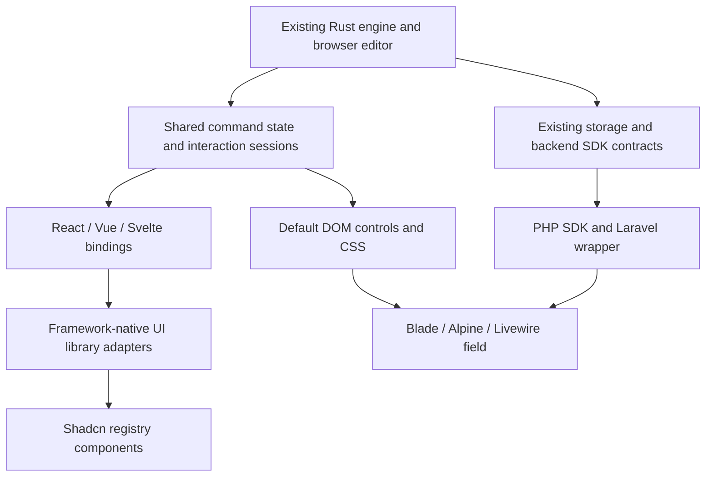

# Editor styling, controls and UI integrations

Status: PROPOSED — researched 2026-10-24. This is an additive product and package plan, not implemented support or an executable runner queue. Names below are proposed unless explicitly identified as existing. Adoption must reconcile existing delivery owners at a safe coordinator checkpoint; it does not change the running queue, start a controller or authorize publication.

The [bounded implementation roadmaps](../runner-queues/editor-ui-integrations-20261024/README.md) now define delivery, dependencies and final acceptance. The [native UI contract](native-ui-integrations.md) extends this proposal with platform controls, required React Native/Expo and Flutter mobile/web profiles, and explicit desktop embedding limits. Both are staged planning sources; the active runner is unchanged.

## Product decision

Ship an attractive, accessible editor with useful default controls, while allowing applications to replace its appearance and controls independently. Plain JavaScript, React, Vue and Svelte must each have a supported route. React must be an optional integration, never a dependency of the engine, browser editor, default styles, or Filament field.

Separate five concerns: semantic commands; view state and interaction sessions; framework lifecycle; accessible component-library integration; visual design. Backend persistence is a sixth, independent concern, supplied by the [backend SDK plan](backend-sdk-adapters.md). Avoid a package for every frontend × component library × backend combination.

Every path uses the same editor instance, commands, selection authority, history and save receipts. UI packages neither deserialize a competing document model nor keep an independently writable copy of content.

## Current implementation and gaps

Inspected source, not a qualification claim:

| Existing path, relative to workspace root | Reusable foundation | Gap addressed here |
| --- | --- | --- |
| `core/packages/web/styles/editor.css` | Optional scoped content CSS, custom properties, forced-color rules and basic command-group styling | Toolbar styling uses a sibling relationship and the English `aria-label="Editing commands"`; lacks a stable public component/theme contract |
| `core/packages/web/src/ui/commands.ts` | `CommandControls`, guarded captured targets, clipboard cancellation and explicit disposal | Hard-coded DOM/control layout, inline style rules and labels; no complete interchangeable product toolbar surface |
| `core/packages/web/src/commands/catalog.ts` | Shared command IDs and shortcut catalog | Needs a public view of availability, active/mixed state, values and presentation contributions without duplicating semantic execution |
| `core/packages/react/src/index.ts` | `useEditor`, `useEditorState`, `EditorHost`, external-store subscription and async teardown handling | Lifecycle bindings exist; polished composable controls and library-specific adapters are additional work |
| `core/packages/astro/src/Editor.astro` | Non-React host and browser lifecycle bridge | Integrate the same default UI and CSS without introducing a React island requirement |
| `docs/examples/recipes/toolbar.mjs` | Host composition over captured commands | A recipe is not a supported reusable toolbar; it even uses a different label from the stylesheet selector |

Existing package manifests include core, web, React, Astro, Markdown and formats; no Vue or Svelte package was present in that inventory. The backend plan already owns their future lifecycle adapters. Codanna was unavailable during inspection, so these findings use focused source reads.

Preserve the [web contract](web.md), [block actions](block-actions.md), [extension presenters](extension-presenters.md), [extension DX](extension-dx.md), [package ownership](packages-release.md) and [durability](document-durability.md). In particular, extend the existing captured-command and presenter mechanisms rather than implementing a second command registry or arbitrary editable node renderer. Keep schema `editac.registry.editor` and profile `editac.yrs-yjs.editor` independent of UI package versions.

## Default product surface

Table refinement, 2026-11-08: [table controls](table-controls.md) requires contextual table/axis/cell surfaces, guarded geometry and axis manipulation under UDM-1.10–1.12. Keep completed direct-cell/paste owners and the common semantic/UI boundary; final NTC proof remains UTW-1.2 and runtime observations roadmap43.

User correction, 2026-10-25: [table paste and direct cell editing](table-paste-and-editing.md) is required for the default rich editor. Pasted tables must present one coherent document grid and edit cell content directly, without a permanent textarea/input and duplicate preview in every cell. UDM-1.8/1.9 deliver the adapter; UIS-1.4 supplies scoped appearance and UTW-1.2 owns final TPT-01–08 UI proof. Existing semantic table receipts do not establish this product outcome.

The initial design should be familiar to users of Tiptap-style editors: compact grouped icon controls, a block-type selector, clear pressed states, separators, contextual menus and restrained borders. Use edit.ac branding rather than copy another product's assets or exact layout.

| Surface | Required initial behavior |
| --- | --- |
| Editor frame | Label/description/error associations, optional border, padding, focus-within treatment, read-only/disabled/loading states |
| Toolbar | Undo/redo, configured marks, block type, link action and registered insertion actions; hide unsupported features or show disabled reasons consistently |
| Selection toolbar | Optional contextual formatting, stable selection target, accessible keyboard entry/exit; no mandatory floating toolbar |
| Block actions | Existing Turn into, Insert after and block menu capabilities; only qualified conversions enabled |
| Slash/search menu | Grouped command results, keyboard activation, loading/empty/error states, cancellation and explicit unavailable reasons |
| References/mentions | Searchable options with labels, descriptions and decorative icons; stable ID selection and asynchronous result cancellation |
| Link/asset dialogs | Guarded target, validation, pending/error states, progress/cancel where the host service supports them |
| Status | Local changes, saving, durably saved, offline, conflict and recovery states from the real persistence owner |

Inventory every currently rendered extension panel, empty/loading/error view, table control, media caption, code control, tooltip and paste-cancel surface before declaring default styling complete. This plan styles existing capabilities and future registered controls; a visible button must not imply an unimplemented semantic feature.

Provide document, compact/comment and minimal presets as editable UI configurations, independent of extension/content presets. Toolbar configuration must not load optional semantic extensions. A disabled action never discards unsupported or unknown content.

### Styling contract: outside, inside and overlays

Expose explicit, documented hooks such as `data-editac-part="toolbar"`, `data-editac-part="toolbar-button"`, `data-editac-state`, and per-surface class/style slots. Names are illustrative until the contract task freezes them. Never use translated text or accessible labels as CSS selectors.

Separate imports for structural styles, content typography and default chrome/theme. Structural rules protect editor layout/selection only; semantic operations must work without decorative CSS. Retain the existing `@edit-ac/web/styles.css` entry as the one current content-style entry unless the pre-publication export review replaces it; do not add competing legacy implementations. Proposed `@edit-ac/web/ui.css` owns default chrome. A default UI factory includes or clearly requires the default stylesheet; a headless import brings no decorative CSS.

Use scoped CSS variables, logical properties, low specificity and declared cascade layers. No global reset, mandatory Tailwind, forced font download or document-wide heading/button selectors. Theme variables cover colors, border/radius/shadow, spacing/density, typography, selection, focus, semantic status and overlay stacking. Support light, dark, system preference, RTL, high contrast/forced colors and reduced motion. Permit independent themes on two editors on one page.

Content typography tokens must remain independent of chrome density. Host overrides may style semantic content, but cannot replace source IDs, editable DOM ownership, anchors, composition boundaries or accessibility relationships. Persisted color/font/alignment features are semantic extensions with validation and export rules; CSS preferences are not saved as document semantics.

Portaled overlays receive the originating editor's theme, direction, locale and owner ID. Provide an explicit overlay container, especially for dialogs, sheets, Shadow DOM hosts and Filament modals. Define focus restoration, collision positioning, clipping, scroll/resize updates, stacking, zoom and mobile viewport behavior. Do not mount everything into `document.body` by default regardless of host constraints. Shadow DOM support remains a qualified host profile, not a promise inferred from accepting a container.

## Shared customization APIs

The [authored surface and package ledger](editor-ui-surface-ledger.md) freezes UIC-1.1's existing exports, rendered controls/statuses, proposed owners and optional peer boundaries. Existing callable seams are listed there separately from the requirements below; presence in the ledger never enables an action.

UIC-1.6 freezes the [staged owner handoffs](../runner-queues/editor-ui-integrations-20261024/adoption-map.md#existing-owner-acceptance-additions): each reused parent has one existing owner, its current deliverable path, one additional UI requirement and a ledger boundary. The [source/interface receipt contract](../runner-queues/editor-ui-integrations-20261024/adoption-map.md#sourceinterface-receipts) determines whether a consumer may reuse an interface. Ownership is resolved; the additions remain staged until the existing coordinator adopts them. Missing lifecycle, native bridge or save APIs return to that row's owner. No owner task, active snapshot or queue is amended by this contract delivery.

These are contract requirements; the frozen command view data/projection below is exported today. Remaining runtime adapters and presentation exports retain their existing delivery owners.

| Contract | Required shape and rules |
| --- | --- |
| Command descriptor | Stable existing ID, localized label/description, icon key, shortcut display, group/order, applicable surfaces and parameter schema |
| Command snapshot | Available/enabled, disabled reason, active/mixed state, current value, pending state and readonly/permission constraints; derived from the owning editor |
| Selection/target session | Capture before focus moves; associate allowed toolbar/dialog/portal owners; execute or prepare using existing guarded targets; dispose on close, replacement or unmount |
| Layout configuration | Include/exclude/reorder/group actions; insert custom items; choose compact/overflow behavior and fixed/floating placement |
| Renderer slots | Replace toolbar/button/group/separator/menu/option/dialog/status/icon renderers; pass typed state and callbacks, never require framework components in portable descriptors |
| UI contribution | Extension supplies namespaced controls and suggestions beside its existing semantic registration; duplicate IDs, order conflicts and unsupported capabilities have deterministic handling |
| Suggestion provider | Trigger/query context, stable target, bounded result count, stable item IDs, grouping, cancellation signal, loading/errors and explicit activation; stale/out-of-order responses cannot apply |
| Subscription | Immutable snapshots with stable identity until relevant change; selector/equality support; per-editor ownership and disposal; document patches do not rerender an entire app |
| Host services | Asset picker/upload, reference search, link resolution and dialogs supplied explicitly through existing service boundaries; UI adapter does not embed provider credentials |

Keep commands authoritative at execution time: read-only state, permissions, extension policy, target validity and conversion impact may change after rendering. A stale target returns a typed rejection; it never silently uses the current caret. Respect the existing command-specific validity rules rather than invalidate or accept every command solely by a global revision check. Async callbacks never restore focus after another editor gains ownership. IME composition and native input paths retain their current gates.

An extension should register its semantic action once and attach presentation metadata for toolbar, slash menu, block menu and shortcuts. Host UI overrides change presentation, not the command's safety classification. Presenter callbacks are trusted host code and remain outside serialized document data; rich option labels use safe text/component rendering, not arbitrary remote HTML.

### Current web controls entry (UCS-1.6)

`@edit-ac/web/controls` exports the current command catalog/projection/view,
captured-target types, contribution admission/layout/activation, bounded
suggestions, overlay lifecycle and theme/part/renderer-slot declarations. Its
explicit ESM/types paths are `dist/ui/controls.js` and `dist/ui/controls.d.ts`.
The existing root re-exports the same barrel and identities. No aliases,
framework runtime or automatic CSS import are added; import does not mount,
fetch or initialize WASM. Editor creation/capture remain on the existing editor
API. Commands retain semantics, validation, policy and history; presenters own
widget keys, labels, host services and disposal. Native consumers reuse portable
data through their existing bridge owners, never the web overlay as a native
widget. Default DOM presenters and `/ui` retain their existing UDM owner.

### Frozen command view contract (UIC-1.2)

The web root exports `projectCommandView` and the `CommandObservation`, `CommandViewInput`, `CommandViewState`, `CommandViewSnapshot`, `CommandViewSelector`, `CommandViewEquality` and `CommandView` types from `commands/view.ts`. The projection visits only the existing `commandCatalog`; it neither registers commands nor captures/executes targets. `CommandPressed` is `boolean | 'mixed' | null`, `CommandValue` is a scalar or null, and `CommandPermission` distinguishes allowed, denied and unknown. Every observation explicitly supplies availability, applicability (`enabled`), a nullable disabled reason, pressed/value, pending and permission; missing observations must fail closed. A descriptor never supplies availability.

`CommandViewInput.lifecycle` reads the owning `BrowserLifecycle` ready/readOnly/phase fields. Its pure `read(id)` reads the existing command owner. Formatting `ToolbarTarget.state` maps on/off/mixed to true/false/mixed; disabled is unavailable, never an enabled toggle. Formatting values, target applicability, command policy and pending work must come from their actual owners. `CapturedCommand.active` alone is not semantic applicability. The input represents one coherent owner observation; reading it must not acquire anchors/listeners, initialize DOM/WASM, execute or mutate document state.

The pure projection produces frozen scalar rows and a frozen record keyed by the current portable command IDs. Pass the same editor's previous result: unchanged rows retain identity and the whole record retains identity when all rows match. Lifecycle/storage changes outside the projected fields do not force a new snapshot. Gating precedence is closing/destroyed, not-ready, readonly, denied/unknown permission, pending, unavailable, then inapplicable; enabled rows have no disabled reason. Availability remains separate from enabled so readonly controls can remain visible. Execution always rechecks the guarded owner.

`CommandView` freezes the live adapter contract: `getSnapshot`, `subscribe(selector, listener, equality?)`, and idempotent `dispose`. Subscription has no initial emission, defaults equality to `Object.is`, retains the old selected value on equality, and notifies only after refreshing the projection. Object-producing selectors provide equality. Unsubscribe is idempotent; observer errors cannot prevent peer delivery. Disposal revokes subscriptions without destroying the editor, leaves the final immutable snapshot readable and rejects later subscriptions. UCS-1.1 implements editor event wiring and the live adapter; UCS-1.6 owns `/controls`. UIC-1.2 does not claim those runtime interfaces are instantiated by `BrowserEditor` yet.

UCS-1.1 implements the live adapter as the web root's `createCommandView(owner, source)` from `ui/command-view.ts`, with `CommandViewOwner` and `CommandObservationSource`. A `BrowserEditor` supplies the lifecycle owner; the host supplies pure `read(id)` observations and change subscriptions from its existing command owners. `source.owner` must be the same object as `owner`. The adapter subscribes to both lifecycle and command changes, fails closed for missing/failed observations, and releases only its own subscriptions on disposal. It does not capture targets, manufacture semantic applicability or replace command guards. `/controls` remains UCS-1.6.

The canonical prepared input/expected transcript is `core/tests/fixtures/ui-command-view.json`: bold, unchanged, mixed, readonly, permission, pending, not-ready and disposed frames. UIC-1.2 inspects these source expectations and typechecks exports; UCS-1.1 executes the bounded selector fixture against the production adapter and real lifecycle subscriptions. Browser target/session behavior and final qualification remain with their existing owners.

### Frozen target and contribution contracts (UIC-1.3)

The current web root exports `UIOverlayOwner`, `UITargetRequest`, `UITargetBinding` and `UITargetSession` from `commands/target-session.ts`; `prepareUIContributions`, `UIContributionError`, `UISurface`, `UIActionReference`, `UIContribution`, `UIContributionAuthority` and `UIContributionErrorCode` from `extensions/ui-contributions.ts`; and `UISuggestionRequest`, `UISuggestion`, `UISuggestionProvider`, `UISuggestionState` and `UISuggestions` from `ui/suggestions.ts`. These declarations and pure metadata admission are delivered. UCS-1.2 implements `BrowserEditor.captureUITarget(owner, request)` over existing command/formatting/history owners; `editor.editorId` supplies the per-instance owner identity. Requests select canonical command IDs or formatting/history targets. UCS-1.3 implements the layout and activation adapters below; UCS-1.4 implements the suggestion controller below. No new package/subpath, command registry, presenter runtime or editable model is implied.

| Target/session field | Existing authority and required adapter behavior |
| --- | --- |
| `owner.editorId`, `owner.id`, `owner.container` | `BrowserEditor.editorId`, host-owned overlay ID and explicit HTMLElement focus container; pass the same container as `BrowserEditor.captureCommand`'s `focusOwner`. Toolbar, dialog and portaled controls participating in that session must be descendants of it, in the editor's document. No inferred body container, cross-editor transfer or asynchronous focus restoration. |
| `binding.kind = command`, `binding.command`, `binding.target` | Existing canonical `PortableCommand` and `CapturedCommand`; `KeyboardInput.captureCommand` owns copied anchors, single-use intent, revision/focus checks, policy recheck, execution and disposal. Stale/revoked activation returns existing `CommandResult` with `rejected` / `stale-or-unavailable-command-target`; no current-caret fallback. |
| `binding.kind = formatting`, `binding.target` | Existing `ToolbarTarget` state/applicable/format/apply/clear; preserve its command-specific validity and own focus policy, including blocked foreign editable controls. UCS-1.2 passes the explicit container through optional capture focus parameters: contained ordinary dialog controls may own focus, another contenteditable surface may not. Calls without a container preserve legacy focus policy. |
| `binding.kind = history`, `binding.target` | Existing `HistoryTarget` from `captureHistory`; retain its validity and per-execution command-policy checks. History owns its revision update after an accepted operation. |
| `id`, `active`, `signal`, `dispose` | UCS-1.2 owns a unique session within the editor, liveness observation and abort/disposal over the selected existing target. Its exposed delegates must be revocable, including a previously retained callback. `active` is not semantic applicability. Close, replacement, unmount and disposal abort pending work and dispose the captured owner once; never destroy the editor. |

Capture while the editor owns focus, before controls move it. A session never substitutes another target after revocation, broadens the owner container, or transfers to another editor. Target validity stays command-specific: do not add a universal revision rule over formatting/history. The session adapter must reject after disposal even if a host retains `binding.target`; it may not expose the raw owner as an unrevocable escape hatch. UCS-1.2 supplies frozen revocable delegates, one current session per editor (including reentrant replacement), AbortSignal and close/unmount/lifecycle cleanup. The explicit connected same-document container cannot be body/documentElement. Native dialog close within or around that container revokes it; hosts dispose custom dismissals. Removal revokes even if reattached before observer delivery. Focused live multi-editor/overlay proof belongs to UCS-1.2; final platform qualification remains separate.

`prepareUIContributions(input, authority)` performs synchronous pure metadata admission, copying and freezing only declared data fields, action and surfaces. It neither loads a feature nor captures/executes/registers commands. `authority` is a read-only observation of already configured feature IDs and existing canonical catalog/slash registrations, supplied by their owner; it is not a second registration API or an execution grant. Reference `kind=command` uses canonical catalog IDs only (aliases rejected); `kind=slash` refers to an existing `SlashCommand.id` and its presenter `prepare`/guarded commit path. Additional presenter capabilities are unsupported until their existing owner supplies an explicit reference contract; arbitrary callbacks/semantic definitions do not enter UI metadata.

Admission is atomic: at most 500 entries; IDs are `feature/local`, both matching `[a-zA-Z][a-zA-Z0-9_.-]{0,63}`. Group/icon keys use the same bounded name; labels are nonempty and at most 128 UTF-16 code units; order is a safe integer in -10000..10000. Surfaces are a nonempty unique subset of toolbar/slash/block-menu. Validate shape, then duplicate ID, then exact feature/action registration in declaration order. Reject the whole list with `UIContributionError(code, index)`: limit and a non-array declaration use index -1; invalid, duplicate and unregistered identify the first offending declaration. No partial list escapes. Order the accepted immutable metadata by group code-unit order, numeric order, then ID code-unit order; ties never depend on locale, input timing or feature load order. A policy change after admission must still reject at the existing execution owner. UCS-1.3 applies host include/exclude/group/reorder and localized rendering over this admitted metadata without rewriting semantics.

UCS-1.3 exports `resolveUILayout(input, authority, surface, layout?, presentation?)`, `UILayoutOptions`, `UIContributionPresentation`, `UISurfaceGroup`, `UISurfaceModel` and `activateUIContribution` from the existing web root. Resolution admits the complete input plus host `layout.items` (combined cap 500) before any surface/include/exclude filtering. Exclusion wins and an explicit empty include returns no items; unknown host references are ignored without feature loading. Invalid host lists/maps/labels/icons reject atomically with TypeError; ID lists/maps are bounded to 500 and the existing name/label/icon grammar, with duplicate list entries rejected. Host `groups` maps contribution IDs to group IDs; `groupOrder` lists groups first, then code-unit group ID. Within each group, `order` lists item IDs first, followed by numeric order and code-unit item ID. Presentation overrides labels/icons only. All output model/group/item/action/surface data is copied and frozen. `compact`, `overflow` (wrap/menu) and `placement` (fixed/floating) are presentation data, defaulting to false/wrap/fixed; mounting, overflow widgets and collision positioning remain presenter owners.

`activateUIContribution(editor, item, session?, text?)` routes a canonical command only through a live matching command session owned by that editor; it preserves existing guarded results and never recaptures. A slash reference delegates only to that editor's already-open configured SlashPresenter.activate, preserving its current query/target/registration/policy/prepare/commit checks and Promise<void> return (dispatch is not a commit receipt). Missing/revoked/mismatched command owners or absent/closed slash presenters reject. Metadata and configured authority observations grant no execution permission and must stay current with the semantic owner. The adapter imports neither BrowserEditor nor SlashPresenter at runtime. UCS-1.3's focused canonical layout/duplicate fixture and prepared delegate-routing observation are distinct from UCS-1.2's actual browser target/guard evidence and final UI qualification; `/controls` remains UCS-1.6.

Suggestion providers return bounded data and never activate, mutate, focus or upload an implicit document. `UISuggestionRequest` identifies editor/session, monotonic request ID, trigger, query, explicit limit and AbortSignal. UCS-1.4 validates trigger/provider/item names (same 1..64 ASCII name grammar), query <=256 UTF-16, limit 1..50, unique stable item IDs, nonempty labels <=128 UTF-16 and optional text <=4096 UTF-16. Each result references an admitted contribution ID; reject unknown IDs, excess counts and malformed results without partial application. Empty results produce empty state. Loading, ready, empty, cancelled and error are explicit; errors distinguish invalid-response/provider-failed/timeout without leaking provider exceptions.

The controller allows one request at a time with a 10-second deadline and zero automatic retries. On a newer query, target revocation, policy change, close or disposal, abort and invalidate the previous generation; a provider ignoring abort still cannot publish or activate stale results. Revalidate editor/session/request identity and signal after every async completion and immediately before explicit activation; dispatch only through the existing registered target/presenter. Completion alone never executes or restores focus. `UISuggestions` subscriptions have no initial emission, return idempotent unsubscribe, isolate observer errors, and are revoked on idempotent disposal. Keep the final immutable snapshot readable, reject new subscriptions/queries after disposal, and return a typed `rejected`/`disposed` result for later activation. Capture/registration/permission failure rejects rather than selecting a new caret. No provider implementation or live calls are included here.

UCS-1.4 implements the existing root's `createUISuggestions(editor, session, provider, source, options?)` with `UISuggestionSource` and `UISuggestionOptions`. The source belongs to the same editor and returns current contributions, configured authority observations and a nonempty revision (at most 256 UTF-16 units); it notifies and changes revision on registration, policy, permission or principal replacement. The controller subscribes to that source, editor lifecycle and target abort, rechecks current observations on completion/activation, and owns only those subscriptions. The optional limit defaults to 20. Data-only results are copied, validated atomically and frozen. Existing command delegates retain their semantic result. Slash completion yields `handled`/`slash-dispatched`, explicitly dispatch rather than commit evidence. Reference-atom search and authorization remain separate existing `ReferenceLookupSession`/`ReferencePresenter` owners. The focused canonical input `core/tests/fixtures/ui-suggestions.json` supplies out-of-order/cancelled prepared queries; the UCS-1.4 selector executes them against production state and activates one still-valid contribution reference through an actual BrowserEditor captured target. Final qualification and `/controls` remain with their named owners.

The canonical prepared source-inspection input is `core/tests/fixtures/ui-target-contributions.json`: accepted, disposed and policy-revoked captured commands, stable ordering/duplicate/unregistered metadata, and out-of-order suggestion completion/disposal. UIC-1.3 typechecks these boundaries and inspects expectations against existing owners; it does not execute live sessions, providers, UI controls or final qualification. UIC-1.5 later registers the focused dispatch recipe.

### Web overlay lifecycle (UCS-1.5)

The current web root exports `mountUIOverlay(editor, session, element, options?)` and `UIOverlay`, `UIOverlayOptions`, `UIOverlayPosition`, `UIOverlayRect`. The captured `UITargetSession` is the focus/semantic authority. Mounting validates the matching editor and live session, consumes one explicit session per wrapper, and rejects a container outside any initiating open native or modal ARIA dialog. It appends only to that session's connected explicit owner; an already connected element must be its direct child. The element cannot contain the editor or owner. Each mounted wrapper receives the originating root's resolved tokens (including overrides), color scheme, direction, language and editor identity synchronously before paint. The shared host container is never restyled. This is the DOM-resolved implementation of the overlay theme context; portable native `UITheme` data retains its separate mapping owner.

`refresh()` updates context and invokes the optional synchronous position hook with frozen anchor/container/visual-viewport rectangles in client CSS pixels. Ancestor context changes, element/container/root resize and nested scrolling schedule refresh; no CSS import, keyboard lease, focus trap or widget key handlers are installed. A host positioner owns collision/transform policy; without it the wrapper uses normal host CSS flow. The existing `EditorViewport` retains ordinary presenter-control layout: only the active editor/control owner may float an offscreen control, and native/modal dialog bounds constrain its available panel. Other editors' controls return to local layout on focus transfer. Geometry events never acquire a caret or focus.

The session's abort, consumed/stale target, foreign editor focus, native close, wrapper removal/reparenting or explicit idempotent `dispose()` releases listeners/observers/pending frames, unmounts that wrapper and revokes its target. The shared editor remains alive. Removal then reinsertion still revokes; reopen requires a new captured session. Presenters retain all widget keyboard/focus management, and activation uses existing guarded delegates. The UCS-1.5 selector observes actual two-editor pointer launchers and nested-dialog close/reopen with current command targets; final platform/AT/Shadow DOM qualification remains deferred to the existing owners.

### Frozen theme, part and slot declarations (UIC-1.4)

`core/packages/web/src/ui/theme.ts` is the single naming authority for
`UI_THEME_TOKENS` (semantic field → CSS custom property) and `UI_PARTS`
(`data-editac-part` values). Existing `--editac-foreground`, `--editac-background`,
`--editac-muted`, `--editac-border`, `--editac-accent`,
`--editac-code-background` and `--editac-paragraph-gap` retain their names.
Content, chrome and overlay part groups share these tokens without label or DOM
position selectors. `UISlotStyles` supplies optional per-part class/style hooks;
`UIRendererSlots<Result>` declares host renderers without importing a framework.
Slot props carry existing immutable command state, revocable target sessions and
an adapter-owned `onActivate` callback. That callback delegates through existing
guarded owners and handles their results/errors; rendering/focus never invokes it.
A renderer may replace presentation only: it must preserve the owning adapter's
roles, labels, keyboard/focus handlers, target checks and disposal. Editable
descendants remain exclusively owned by the editor. Native builders stay in the
host language; web renderers, styles and session objects never enter a DTO.

`UITheme` is the portable presentation data declaration. The strict bounded
native shape is `core/contracts/ui-theme.schema.json`, mapped in the
[native contract](native-ui-integrations.md#frozen-theme-data-mapping-uic-14).
The planned `sdk/contracts/` location is reconciled to existing `core/contracts/`;
there is no second SDK or runtime protocol. Native ingress validates the schema
before applying any field. UIC-1.4 declares this boundary; existing bridge owners
implement ingress, executor routing and live updates.

Each editor receives its own `UIThemeContext`: stable editor ID, resolved theme,
explicit locale and direction. Locale is a host-owned BCP-47 tag (1–63 ASCII
characters); direction is explicitly `ltr` or `rtl`, never guessed from locale.
The host resolves system color/motion/contrast preferences and refreshes the
context when they change. Theme identity is independent of document identity,
history and persistence. Two editors can use different themes/locales/directions
at once; no document-root variables or singleton theme store is permitted.

The `UIOverlayThemeContext` declaration binds an explicit existing
`UIOverlayOwner` to the originating editor's entire context. Mounted DOM wrappers
resolve that context from their captured originating editor as described above. Owner editor IDs
must match or mounting rejects. Inherit all token values (including host
overrides), `dir` and `lang` onto that container before it becomes visible; CSS
ancestry alone does not propagate to portals. Refresh open overlays on context
changes and remove owned bindings on disposal. Never infer `document.body`,
retarget another editor, or overwrite a shared portal root with one editor's
theme. A shared host supplies distinct per-editor overlay wrappers. UCS-1.5
provides the web mount/position lifecycle; presenter focus restoration and final
Shadow DOM qualification retain their existing UDM and qualification owners.

`core/packages/web/styles/README.md` freezes stylesheet responsibilities and
token value constraints. The current `styles.css` content entry is preserved;
structural separation and default `ui.css` styling remain UIS, not newly enabled
imports. The prepared declaration example is
`core/tests/fixtures/ui-theme.json` (independent light/LTR and dark/RTL editors,
overlay inheritance and native data). It is source/compilation evidence only,
not visual, accessibility or live theme propagation qualification.

### Keyboard and accessibility ownership

The shared layer owns editor target/session state. The chosen component library owns its widget keyboard/focus implementation. Do not run default DOM roving-focus handlers underneath React Aria, Base UI, Radix, Reka or Bits handlers.

Default DOM controls need a complete accessible implementation: toolbar role and label, logical arrow navigation, Home/End behavior, orientation/RTL, focus retention when items disappear, visible focus, disabled policy, pressed/mixed state, named icon buttons, and working tooltip descriptions. Implement the established toolbar pattern rather than merely changing `role="group"` to `role="toolbar"`. Touch mode retains at least the existing 44px control targets; compact desktop styling must retain usable hit areas.

React Aria's [Toolbar](https://react-aria.adobe.com/Toolbar) and [ListBox](https://react-aria.adobe.com/ListBox) are useful references. A ListBox represents option selection; its items cannot contain interactive buttons. Use Menu semantics for command actions and GridList or a dialog when result rows need interactive children. [Autocomplete](https://react-aria.adobe.com/Autocomplete) supports searching collections with virtual focus, but its documented input patterns do not by themselves qualify a contenteditable slash implementation.

Explicitly design two focus profiles: a palette with its own search field, and inline suggestions retaining focus/composition in the editor. Prove the inline active-descendant/ownership pattern with the actual editor and assistive technology; do not pretend the editable root is an ordinary text input. On Escape, cancel without editing; on activation, use the captured range. Preserve IME, text navigation, list announcements and mobile keyboard behavior. Full target-platform/assistive-technology observations remain final qualification work, with unsupported claims visible.

## Package plan

Repository planning update, 2026-10-26: [Decision 007](../decisions/007-integration-repositories-and-packages.md) and the [integration distribution plan](integration-distribution.md) require a dedicated repository and package for each maintained framework/component-library integration. Existing package identities and useful subpaths stay intact. Source-owned registry kits have dedicated repositories and versioned registry distributions. Existing task IDs retain feature ownership until extraction; all new names remain provisional pending exports, registry availability and namespace ownership checks.

| Distribution or subpath | Responsibility | Dependency boundary |
| --- | --- | --- |
| Existing `@edit-ac/core`, `@edit-ac/web` | Engine, browser surface and existing storage/extension contracts | No UI framework or component library dependency |
| Existing `@edit-ac/web/controls` | Current view descriptors/subscriptions, interaction-session bridge, layout/suggestions/overlays and theme declarations | Reuses web command APIs; import does not mount, fetch, load CSS or initialize WASM |
| Proposed `@edit-ac/web/ui`, `@edit-ac/web/ui.css` | Default DOM controls and optional product styles | No React, Vue, Svelte or Tailwind; opt-in runtime export |
| Existing `@edit-ac/react`, proposed `/controls` and `/ui` subpaths | Lifecycle plus idiomatic state hooks and default React composition | React peer only; root lifecycle import does not pull all UI |
| Planned `@edit-ac/vue`, `@edit-ac/svelte` with matching subpaths | Vue composables/components; Svelte action/component and reactive view state | Own framework peers only; lifecycle delivered by existing backend-plan owners |
| Existing `@edit-ac/astro` | Astro host plus default DOM UI and CSS integration | No React dependency; reuse existing custom-element bridge |
| Proposed `@edit-ac/react-base-ui` | React controls implemented with Base UI primitives | React binding and Base UI peers |
| Proposed `@edit-ac/react-aria` | React controls implemented with React Aria Components | React binding and React Aria peers |
| Proposed `@edit-ac/react-radix` | React controls implemented with Radix primitives | React binding and selected Radix peers |
| Proposed `@edit-ac/vue-reka` | Native Vue controls implemented with Reka | Vue binding and Reka peers |
| Proposed `@edit-ac/svelte-bits` | Native Svelte controls implemented with Bits | Svelte binding and Bits peers |
| Shadcn registry source, separated by framework and primitive family | Application-owned styled components and editor compositions | Uses the matching adapter; no universal shadcn runtime package |
| Existing planned PHP/Laravel/Filament distribution boundaries | Plain PHP SDK, Laravel wrapper, optional Filament field | Backend plan remains sole owner; Filament uses default web UI |

Do not introduce a generic `@edit-ac/ui` aggregator that installs all frameworks. Framework packages may expose small default components, but a framework reconciler must never render editable descendants or mount a second toolbar over the same controls. Imperative default UI and framework-rendered UI are alternative presenters of the same controller.

Use ESM/types, explicit exports, CSS side-effect declarations, peer dependency ranges and independently testable imports. Resolve one core/web dependency graph and one engine asset set even on pages mixing adapters. SSR import and rendering must not touch browser globals, start persistence/network work or instantiate an editor; mount on the client. Next, Nuxt and SvelteKit have dedicated thin integration repositories/packages over their existing framework bindings and shared SDKs, preserving one semantic implementation. React Strict Mode, request isolation, hydration, Astro navigation and asynchronous destruction all need explicit lifecycle proof.

## Framework and component-library coverage

“First-class” means maintained typed APIs, the complete agreed surface set, actual installed-package examples, lifecycle tests, theme/focus integration, declared peers and a responsible release owner. A wrapper around Bold does not meet that bar. “Recipe” means documented composition with a tested example, without a separate supported adapter API. All future rows below remain planned until their acceptance passes.

| Framework | First delivery | Broader coverage and limits |
| --- | --- | --- |
| Plain JS / Blade / Alpine | Default DOM UI and CSS | Primary non-React reference; Vite and direct-host recipes |
| React / Next.js | Existing lifecycle, default controls, Base UI, React Aria, Radix; shadcn Base UI and Radix variants | MUI, Mantine, Chakra/Ark and Ant Design start as recipes; promote only for a demonstrated reusable adapter boundary |
| Vue / Nuxt | Native binding, default controls, Reka and shadcn-vue | PrimeVue/Vuetify recipes are follow-up candidates, not asserted support |
| Svelte / SvelteKit | Native binding, default controls, Bits UI and shadcn-svelte | Ark UI recipe candidate; no React bridge |
| Astro | Existing non-React host with default UI | Optional chosen framework islands reuse the respective binding |
| Angular | Existing backend-plan lifecycle/form adapter, default DOM integration | Angular CDK/Material presentation follows after lifecycle readiness; not silently dropped from broader scope |
| Solid / Web Components | Follow-up feasibility and demand assessment | Reuse controls and an idiomatic lifecycle bridge; no first-wave support claim |
| Native mobile/desktop | Existing native surfaces and presenter protocol | React Native/Flutter do not use DOM/shadcn packages or replace native input with a WebView |

[Base UI Toolbar](https://base-ui.com/react/components/toolbar), [Radix Toolbar](https://www.radix-ui.com/primitives/docs/components/toolbar), [Reka Toolbar](https://www.reka-ui.com/docs/components/toolbar), and [Bits Toolbar](https://www.bits-ui.com/docs/components/toolbar) provide native widget foundations. React Aria, Base UI and Radix are not cross-framework adapters. [Ark UI](https://ark-ui.com/docs/overview/about) is a useful later comparison because it offers multiple framework bindings; adopting it as the universal mandatory foundation would still be an additional product/dependency decision. [Material UI](https://mui.com/material-ui/) illustrates the separate React design-system recipe tier.

Pin a maintained upstream baseline during implementation and record exact peer ranges in a support manifest. Do not promise every historic framework major or assume current docs prove compatibility. The manifest tracks framework, primitive library, styling/Tailwind baseline, bundler, SSR mode and qualified surfaces separately. Unsupported combinations fail clearly rather than installing a hidden second framework.

## Shadcn delivery

Ship source through ecosystem-native registries/CLIs, matching the [shadcn registry model](https://ui.shadcn.com/docs/registry). Authored component sources belong in Git; generated registry output and packed distributions do not. The semantic/target logic stays in maintained adapter packages while copied visual components can be edited by the application.

1. React: Base UI is the recommended new-app variant; retain a separately tested Radix variant for apps already using it. Shadcn's [July 2026 change](https://ui.shadcn.com/docs/changelog/2026-07-base-ui-default) makes Base UI the default while keeping Radix supported. Registry metadata must explicitly select the primitive family, avoiding silent default changes.
2. Vue: publish matching source for [shadcn-vue](https://next.shadcn-vue.com/docs/introduction) on Reka. It is a separate community port and CLI, not React shadcn installed into Vue.
3. Svelte: publish matching source for [shadcn-svelte](https://www.shadcn-svelte.com/docs) on Bits. Test its actual registry schema and installer separately.
4. React Aria: ship a polished theme with the same edit.ac design tokens. Do not call it an official shadcn primitive variant or silently replace an app's chosen components. An Aria-backed source recipe can be added with that distinction explicit.

Initial registry items: editor frame, toolbar, formatting controls, block-type selector, selection toolbar, slash/command panel, reference picker, link dialog and status. Offer a minimal editor composition and a document composition. Optional feature items declare their extension/service prerequisites and must not install every extension.

Map edit.ac tokens to host [shadcn theme variables](https://ui.shadcn.com/docs/theming), including surfaces, foreground, muted, border/input, primary, destructive and ring. Respect the app's icon library, aliases, CSS entry, dark-mode convention and existing components. Do not overwrite local components, introduce another global preflight, or silently switch Radix to Base UI. Test utility generation in production builds, including dependency scanning when required. Explain the update contract: copied visuals are application-owned; package updates do not overwrite them, and API-breaking source updates need explicit guidance.

## Laravel, Vite, shadcn and Filament reference application

[Laravel's starter kits](https://laravel.com/starter-kits) currently demonstrate React/shadcn, Vue/shadcn-vue and Svelte/shadcn-svelte through Inertia, as well as a Livewire path. Use one application to prove that a public editing frontend and a Filament admin can share the same document and backend without sharing their UI runtime.

| Application surface | Ready-made integration |
| --- | --- |
| Inertia React page | React binding + selected shadcn variant + PHP/Laravel backend |
| Inertia Vue page | Vue binding + shadcn-vue + the same backend contract |
| Inertia Svelte page | Svelte binding + shadcn-svelte + the same backend contract |
| Blade/Alpine page | Default DOM editor UI + the same backend contract |
| Filament Resource field | Separately installable Composer field adapter, Blade/Alpine/Livewire bridge and theme mapping; no React bundle |

Extend the backend plan's example rather than create a competing PHP implementation. The plain PHP SDK owns protocol/persistence orchestration; Laravel maps policies, routes, transactions and storage; Filament owns form-field integration. Client UI hides unavailable actions for usability, while server authorization remains authoritative. CSRF/session handling, upload policies and reference authorization stay in the backend adapter/host services.

The [Filament custom-field API](https://filamentphp.com/docs/5.x/forms/custom-fields) provides field classes/views and nested state paths. Its documented field state mechanism is not permission to entangle a whole live CRDT document into Livewire. Isolate the editor DOM using the appropriate [Livewire ignore boundary](https://livewire.laravel.com/docs/4.x/wire-ignore), and explicitly synchronize the field's document reference/revision and status. `wire:ignore` alone does not solve teardown, disabled state, validation or modal ownership.

Required behavior: nested/repeater field paths; unique editor IDs; lazy-loaded assets; modal/drawer portal ownership; open/close/reopen and navigation cleanup; labels/errors/help; view/disabled policies; unsaved changes; conflict/recovery; final flush before submit or a documented explicit failure. Follow the backend plan's atomic form-save contract: no durable-success label or document attachment before the required transaction/receipt succeeds. New-record attachment and abandoned drafts retain that owner's cleanup rules.

Filament should look native to Filament. The frontend may look native to shadcn. Both consume equivalent edit.ac content styling, command behavior and persistence without attempting to inject React shadcn into a Blade field. Confirm the admin asset graph contains no React unless another independently chosen admin feature requires it.

## Competitor findings and consequences

| Evidence | Design consequence for edit.ac |
| --- | --- |
| [Tiptap installation guides](https://tiptap.dev/docs/editor/getting-started/install) span vanilla JS and several frameworks; its [UI components](https://tiptap.dev/docs/ui-components/getting-started/overview) are a separate layer | Keep engine/bindings distinct from turnkey UI. Do not confuse engine portability with equal UI coverage |
| [BlockNote](https://www.blocknotejs.org/docs/getting-started) separates core/React from Mantine, shadcn and Ariakit options | Independently installable presentation adapters are useful; preserve a non-React first-class path too |
| [BlockNote shadcn setup](https://www.blocknotejs.org/docs/getting-started/shadcn) calls out stylesheet/utility scanning needs | Verify installed production CSS, not only a workspace demo |
| [Plate](https://platejs.org/docs/installation) separates React headless and shadcn UI setup | Source-owned kits can accelerate integration while runtime behavior stays in packages |
| [TinyMCE installation](https://www.tiny.cloud/docs/tinymce/latest/installation/) describes thin framework wrappers | Lifecycle wrappers and reusable default UI are independent deliverables |
| [CKEditor setup](https://ckeditor.com/docs/ckeditor5/latest/getting-started/index.html) distinguishes editor setup and framework integration | Supply opinionated working examples as well as low-level APIs |

These are architectural comparisons, not benchmark, accessibility, license-equivalence or feature-parity claims. Inspect licenses/notices for any reused code or assets; do not copy commercial component code based on a documentation example.

## Delivery sequence and existing owners

The rows below are work packages to split into bounded implementation parents at adoption, not a new running roadmap. Keep the root guard and current queue intact. Default UI can develop against the existing local editor; remote persistence readiness gates only save/load-dependent work. A missing native/backend feature does not block independent toolbar styling.

| Order | Deliverable | Entry and completion boundary |
| --- | --- | --- |
| 1 | Inventory + default visual baseline | Inventory current components and freeze parts/tokens; style existing preview controls, content and states; remove label/DOM-position coupling; no invented semantic actions |
| 2 | Shared controls API | Extend current commands, captured targets, block actions and presenters; typed state/layout/contribution/suggestion contracts plus focused conformance |
| 3 | Product DOM controls | Fixed/selection toolbars, menus/dialogs/status, responsive layouts, focus/portal ownership; usable without a UI framework |
| 4 | Framework controls | Extend React/Astro and consume Vue/Svelte lifecycle delivery; stable subscriptions and native component APIs; no controlled document replacement |
| 5 | Library adapters | Base UI and React Aria first to prove two distinct widget models; Radix, Reka and Bits follow with the same required surfaces and behavior |
| 6 | Shadcn source kits | React Base UI/Radix, Vue/Reka, Svelte/Bits; actual registry installs and production builds; shared semantics stay in adapters |
| 7 | Laravel/Filament reference | Reuse PHP/Laravel/Filament owners; public Inertia + admin field share a document and durable receipts; prove non-React admin path |
| 8 | Broader integrations and qualification | Angular/CDK, additional design-system recipes, support manifests, public guides, final accessibility/target-browser and package qualification |

Ownership reconciliation is mandatory before converting these rows into runner parents:

- Track 08 SDK integration owns package exports, existing React/Astro and packed browser consumers; track 21 owns extension contribution semantics. This plan adds their UI acceptance rather than another engine or facade.
- The backend plan's [web framework milestone](../runner-queues/backend-sdk-adapters-20261024/08-web-frameworks.md) already assigns BWF-1.1–1.8 to React/Astro, Next, Vue, Nuxt, Svelte, SvelteKit, Angular and common forms. Those owners deliver lifecycle/persistence; this plan supplies presentation acceptance. Do not create a second Vue/Svelte binding in `adapters/web` beside `packages`.
- The [Filament milestone](../runner-queues/backend-sdk-adapters-20261024/02a-filament-admin.md), BFA-1.1–1.5, already owns installation, mounting, form save, nested/modal lifetime and the Resource example. Add theme/control acceptance there at adoption.
- Existing block-action owners retain conversion semantics. UI menus consume their availability/impact results; advanced conversions remain disabled until qualified.
- Existing final framework/package testing owners consume the new adapter matrix. Roadmap 43 retains final target-runtime/assistive-technology observations under current sequencing. New surfaces require explicit cases; old passing evidence is not automatic coverage.

## Acceptance and support gates

| Case family | Observable result |
| --- | --- |
| UI-01: default presentation | Every inventoried surface has coherent light/dark, focus, disabled, pending and error styling; narrow layouts do not make commands unreachable |
| UI-02: headless and isolation | Plain JS, Vue, Svelte, Astro and Filament builds do not import React through edit.ac; a lifecycle-only/headless import does not pull other adapter runtimes or decorative CSS |
| UI-03: customization | Reorder/remove controls, replace icons/labels/renderers and register one custom action used by toolbar/slash/block menu; no document/undo fork |
| UI-04: command correctness | Mixed selection, undo/redo, readonly changes, stale target, unsupported feature, cancellation, peer edits and two-editor focus preserve existing guarded-command behavior |
| UI-05: suggestions | Empty/error/loading, slow/out-of-order results, cancellation, result limits, IME and stable references; command and option semantics remain distinct |
| UI-06: widget integration | Each adapter covers the agreed surface matrix with correct keyboard/portal behavior; one widget focus manager, no duplicated activation or undo group |
| UI-07: lifecycle | SSR import/render without DOM/WASM side effects; mount/unmount/remount, navigation, dialogs, pending save teardown and multiple editors behave correctly |
| UI-08: theme integration | Two differently themed editors and portaled overlays, host CSS resets, RTL, forced colors, zoom and mobile viewport; content remains readable |
| UI-09: actual consumption | Isolated npm/Composer consumers and registry installs build without workspace aliases; CSS survives production optimization; assets/dependencies are shared correctly |
| UI-10: Laravel/Filament | Public frontend and admin reopen the same canonical document; nested fields/modal teardown and form-save failure/conflict paths preserve unsaved work |
| UI-11: accessibility qualification | Keyboard and screen-reader flows, toolbar states, inline suggestions, labels/errors, touch and native composition on declared browser/OS/AT profiles |
| UI-12: extension/backend isolation | UI selection does not enable extensions or collaboration, change document identity, expose credentials, or bypass host authorization/durable-save receipts |

During implementation use focused deterministic fixture/mock-transport checks appropriate to the changed boundary. No paid inference, recording from providers or secrets loaded into tests. Full installed-consumer matrices and target-platform observations run at their assigned later qualification phase; mark deferred profiles unqualified. Avoid a Cartesian test explosion: shared semantic contract tests, per-adapter widget tests, per-framework lifecycle profiles and a small set of representative full applications provide distinct evidence. Specifically test both shadcn React primitive variants and all three framework-native shadcn installers.

Measure optional UI/library JS and CSS separately from engine/editor assets and include them honestly in the chosen end-to-end product profile. Retain existing hard readiness caps; do not reclassify bytes to evade them. Use the existing bounded optimization policy so size work does not stall independent features. No current pass, release readiness or time estimate is asserted by this plan.

## Decisions to freeze during adoption

Recommended defaults are plain DOM UI for the framework-independent product, Base UI for a new React/shadcn setup, React Aria as an equal supported alternative, Radix for existing Radix applications, Reka for Vue and Bits for Svelte. Resolve exact public names, maintained upstream peer ranges, inline-suggestion focus semantics and the complete per-adapter surface matrix before implementation claims. Any unmet upstream primitive capability gets an explicit shared/custom implementation decision or a visible support gap; it is not hidden behind a “first-class” label.

The first visible milestone is a styled preview using the real editor and existing controls. The complete integration milestone is an installed Laravel/Vite application with a shadcn frontend and a native Filament field, backed by the same PHP/Laravel persistence path, plus independently usable React, Vue, Svelte and plain-JavaScript packages.
